<p align="center">
  
</p>

<p align="center">
  
  
  
  
</p>

<p align="center">
  <b><a href="https://maristelaoliveira.github.io/Preparatorio-AZ900/">🌐 Abrir o site</a></b>
  &nbsp;·&nbsp;
  <b><a href="https://maristelaoliveira.github.io/Preparatorio-AZ900/#encontros">🗓️ Ver os encontros</a></b>
  &nbsp;·&nbsp;
  <b><a href="https://maristelaoliveira.github.io/Preparatorio-AZ900/#treinos">🎯 Ir direto para os treinos</a></b>
</p>

---

## `$ az account show`


```json
{
  "name": "Preparatório AZ-900",
  "user": { "name": "Profa. Maristela (Stela)", "type": "user" },
  "tenant": "Faculdade de Tecnologia e Inovação Senac DF",
  "state": "Enabled"
}
```

Prazer, eu sou a **Profa. Maristela**, ou só **Stela**! 👋 Esse memoji sou eu. Se ele aparecer no Teams ou no e-mail, pode confiar: não é phishing. 😉

Boas-vindas ao preparatório **AZ-900 · Microsoft Azure Fundamentals**, da Faculdade de Tecnologia e Inovação Senac DF. São **dez encontros práticos** e as trilhas gratuitas do **Microsoft Learn** até a primeira certificação de nuvem da Microsoft.

Este repositório é o **site do preparatório**: o lugar onde ficam os encontros, o seu progresso, os vídeos, os treinos e o caminho até a prova. Nada de slides: aqui a aula é o próprio site.

Serve para quem está começando em TI, para quem vem de outra área e para quem já conhece outra nuvem.

```text
aluno@azure:~$ az group create --name filhotes --location brazilsouth
{
  "name": "filhotes",
  "provisioningState": "Succeeded"
}

aluno@azure:~$ az vm list --query "[?dono=='aluno'].esquecida"
[]   # nenhuma VM esquecida ligada. a sua fatura agradece. 💸
```

> ☁️ "A nuvem é só o computador de outra pessoa." Verdade. Mas é um computador com regiões, zonas de disponibilidade, Azure Policy e uma calculadora de preços. É isso que a gente vai entender.

---

## 🧭 O que tem no site

| | Seção | Para que serve |
|:-:|---|---|
| 📝 | **A prova** | Os três domínios do AZ-900, com os pesos do guia de estudo oficial. |
| 🗓️ | **Encontros** | Os 10 encontros, cada um com prática guiada, desafio com caso, mini-simulado e a tarefa da quinzena. |
| ✅ | **Meu progresso** | Você marca os módulos concluídos nas três trilhas do Microsoft Learn. Fica salvo no seu navegador. |
| 🎬 | **Vídeos** | 12 vídeos curtos, de 8 a 12 minutos: conceitos, demonstração no portal e pegadinhas de prova. Os links ficam no Teams da turma. |
| 🎯 | **Treinos** | "Qual é o serviço?" e o mini-simulado, com explicação em cada resposta. |
| 🏅 | **Até a prova** | Do perfil no Microsoft Learn até o badge, em seis passos. |
| 🔗 | **Links oficiais** | Tudo gratuito, tudo da Microsoft: trilhas, guia de estudo, avaliação prática, demonstração da prova e mais. |

Quer guardar o progresso na nuvem? Use o botão **Entrar**, no topo. É **opcional**: sem login, tudo continua funcionando no seu navegador. As conquistas do seu perfil no Learn continuam sendo a comprovação oficial.

---

## 🧱 A prova: três domínios

O AZ-900 cobre os conceitos de nuvem e o básico do Azure. Os pesos são do guia de estudo oficial, com as habilidades medidas a partir de 20/07/2026. **Nota mínima para aprovação: 700.**

| Domínio | Peso | O que cai | Encontros |
|---|:-:|---|:-:|
| 1 · Conceitos de nuvem | 25 a 30% | Modelos público, privado e híbrido, responsabilidade compartilhada, benefícios, IaaS, PaaS e SaaS | 1 e 2 |
| 2 · Arquitetura e serviços do Azure | 35 a 40% | Regiões e zonas, computação, rede, armazenamento, identidade, acesso e segurança | 3 a 7 |
| 3 · Gerenciamento e governança | 30 a 35% | Custos, governança e conformidade, ferramentas de gerenciamento e monitoramento | 8 e 9 |

> A Microsoft atualiza o exame de tempos em tempos: confira o [guia de estudo oficial](https://learn.microsoft.com/pt-br/credentials/certifications/resources/study-guides/az-900) antes da prova.

---

## 🗓️ Os encontros

Sala de aula invertida: a teoria fica no Microsoft Learn e nos vídeos curtos, e o encontro é para praticar, resolver desafios e treinar para a prova. Em linguagem de nuvem:

```text
aluno@azure:~$ az deployment list --resource-group preparatorio-az900 -o table
Nome   Encontro                                          Domínio   Estado
-----  ------------------------------------------------  --------  ---------
E01    Boas-vindas e o que é computação em nuvem         1         Succeeded
E02    Benefícios da nuvem e tipos de serviço            1         Succeeded
E03    Componentes da arquitetura do Azure               2         Succeeded
E04    Computação e hospedagem de aplicações             2         Succeeded
E05    Redes no Azure e revisão do domínio 1             2         Succeeded
E06    Armazenamento e migração                          2         Succeeded
E07    Identidade, acesso e segurança                    2         Succeeded
E08    Custos, governança e conformidade                 3         Succeeded
E09    Gerenciamento, monitoramento e revisão geral      3         Succeeded
E10    Simulado final e caminho até a prova              todos     Running...
```

| Nº | Encontro | Desafio e caso |
|:-:|---|---|
| 01 | Boas-vindas e o que é computação em nuvem | Nuvem no dia a dia: streaming, banco, gov.br. Provedor ou cliente? |
| 02 | Benefícios da nuvem e tipos de serviço | A pirâmide da responsabilidade em IaaS, PaaS e SaaS |
| 03 | Componentes da arquitetura do Azure | O caso de Brasília: um órgão público precisa manter os dados no Brasil |
| 04 | Computação e hospedagem de aplicações | Qual serviço de computação? VM, contêiner, função ou aplicativo web |
| 05 | Redes no Azure e revisão do domínio 1 | VPN ou ExpressRoute? Uma loja pequena, um hospital, um banco |
| 06 | Armazenamento e migração | Qual camada e qual redundância? Azure Migrate ou Data Box? |
| 07 | Identidade, acesso e segurança | Escape room de segurança: MFA, Acesso Condicional, RBAC e Zero Trust |
| 08 | Custos, governança e conformidade | Desafio do orçamento e governança no setor público com a LGPD |
| 09 | Gerenciamento, monitoramento e revisão geral | Jeopardy do Azure em equipes, revisando os três domínios |
| 10 | Simulado final e caminho até a prova | Correção comentada por domínio e o seu plano até a prova |

---

## 🎯 Os treinos

Treine quantas vezes quiser. Cada resposta mostra na hora o que está certo e por quê. Nada é salvo: é só treino, então erre à vontade.

- **Qual é o serviço?** 14 necessidades para você escolher o serviço do Azure que resolve. Hospedar um site sem cuidar de servidor? Impedir que alguém crie recursos fora da região Brasil Sul? Saber se a falha é do próprio Azure?
- **Mini-simulado:** 13 questões no estilo da prova, uma de cada vez, com explicação.

> 🕵️ **"As questões são as da prova?"**
> Não, e isso é bom! Todas foram escritas para o curso. Questões vazadas da prova ("dumps") violam o contrato da certificação da Microsoft, podem custar o seu resultado e, de quebra, costumam ter gabarito errado. Para treinar com material oficial, use a **avaliação prática oficial**, gratuita no Microsoft Learn.

---

## 🏅 Do Learn até o badge

```text
aluno@azure:~$ az certificacao caminho --até badge
 01  Crie o perfil no Microsoft Learn      é nele que ficam as conquistas e a certificação
 02  Conclua as três trilhas               no ritmo dos encontros, uma quinzena de cada vez
 03  Faça a avaliação prática oficial      gratuita; refaça até o resultado ficar consistente
 04  Conheça o ambiente da prova           a demonstração mostra as telas e os tipos de questão
 05  Agende com a Pearson VUE              presencial ou online; leia as regras do dia
 06  Divulgue a conquista                  badge no LinkedIn 🏅
```

Depois do AZ-900, os próximos passos sugeridos no site são o **AZ-104**, o **SC-900** ou o **AI-900**.

---

## 🛠️ Ferramentas

<p align="center">
  
</p>

| Ferramenta | Para quê |
|---|---|
| 🎓 **Microsoft Learn** | As três trilhas do AZ-900, o guia de estudo, a avaliação prática oficial e a Exam Readiness Zone. |
| ☁️ **Portal do Azure** e **Cloud Shell** | As demonstrações e os exercícios do Learn em sandbox, com o Azure CLI. |
| 🧮 **Calculadora de preços** | O desafio do orçamento do encontro 8. |
| 🎁 **Azure for Students** | Créditos gratuitos para estudantes praticarem. |
| 💬 **Microsoft Teams** | Onde ficam os links dos vídeos da turma. |
| 📅 **Pearson VUE** | O agendamento da prova, presencial ou online. |

O site é feito com HTML, CSS e JavaScript puros, sem framework e sem build. O login opcional usa o Supabase.

---

## 🤖 IA com consciência

A IA pode explicar um serviço, montar um resumo ou criar perguntas para você treinar. Mas quem confere é você: compare sempre com o Microsoft Learn e com o guia de estudo oficial. Na prova não tem IA. E nem precisa: quem entende o conceito acerta a questão. 💪

```text
aluno@azure:~$ az role assignment create --role "Copiar sem ler" --assignee aluno
(AuthorizationFailed) Essa função não existe. Leia, entenda e confira. ❌
```

---

## 🙋 Dicas de sobrevivência

1. **Faça a tarefa da quinzena antes do encontro.** O encontro é para praticar, não para ver a teoria pela primeira vez.
2. **Grupo de recursos é uma caixa.** Apagou a caixa, apagou tudo o que tinha dentro. Pense antes do `az group delete`. 😅
3. **Responsabilidade compartilhada cai muito.** Em IaaS, PaaS ou SaaS, os dados, as contas e os dispositivos de acesso são sempre seus.
4. **Azure Policy impede; bloqueio de recurso protege.** Essa diferença aparece nos treinos.
5. **Refaça a avaliação prática oficial** até o resultado ficar consistente, não só até passar uma vez.
6. **Travou?** Pergunte no Teams. Ninguém nasce sabendo a diferença entre região e zona de disponibilidade.

---

<details>
<summary><b>👩‍🏫 Para a professora (estrutura e como atualizar)</b></summary>

<br>

Site estático publicado no GitHub Pages a partir da branch `main`, sem build.

```text
Preparatorio-AZ900/
├── index.html            # a página do preparatório: prova, encontros, progresso, vídeos, treinos, caminho e links
├── painel.html           # painel da turma (para a professora, com login)
├── css/
│   └── az900.css         # os componentes deste preparatório
├── js/
│   ├── treinos.js        # "Qual é o serviço?" (SERVICOS) e o mini-simulado (SIMULADO)
│   ├── modulos.js        # as três trilhas do "meu progresso" (para o painel)
│   ├── progresso-nuvem.js# o progresso das trilhas na nuvem, para quem entra com login
│   ├── conta.js          # login opcional (Supabase)
│   └── painel.js         # o painel da turma
└── assets/
    ├── css/  js/         # estilo.css, neon.css, placa.js, matrix.js e aulas.js: visual comum dos sites da Stela (não editar aqui)
    └── img/              # ícones, logo, memoji e o banner deste README
```

- **Textos e encontros:** procure os comentários `EDITE AQUI` no `index.html`. Os encontros são numerados e sem data (o material serve para várias turmas).
- **Treinos:** listas `SERVICOS` e `SIMULADO`, no começo do `js/treinos.js`.
- **Trilhas do progresso:** se mudar os checklists no `index.html`, mude também o `js/modulos.js`.
- **Antes de publicar:** testar no navegador, também na largura de celular (390 px).

</details>

---

<p align="center">
  Feito com ♥ e sucata eletrônica pela <a href="https://maristelaoliveira.github.io/">Profa. Maristela</a> · Faculdade de Tecnologia e Inovação Senac DF
  <br>
  <code>az config set estudo=ligado</code>
</p>
